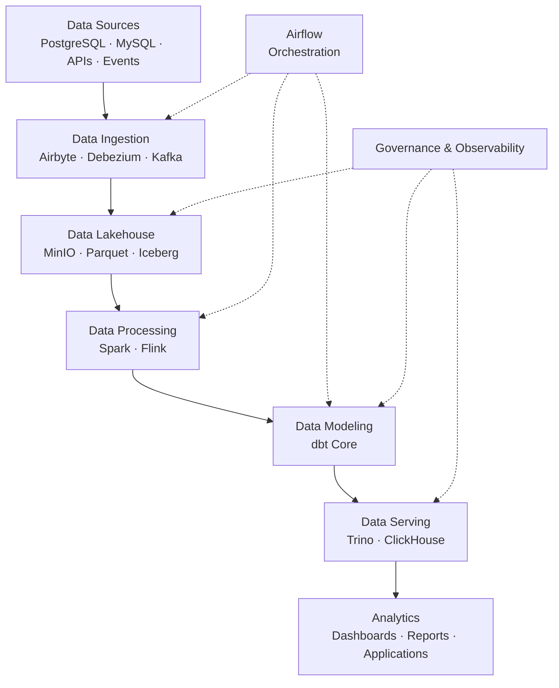

# OmniCommerce Data Platform

**An Open-Source, End-to-End Data Engineering Learning Project**

*Learn Data Engineering by building a real-world, production-inspired data platform from scratch.*


---

## Overview

**OmniCommerce Data Platform** is an open-source, hands-on project designed to help aspiring and experienced Data Engineers learn modern data engineering technologies, architectures, and best practices by building a complete data platform.

Instead of learning tools in isolation, this project demonstrates how different technologies work together to solve real-world data engineering challenges.

The project simulates a modern e-commerce business that generates transactional data, customer activity, product information, application events, and marketing data.

Throughout the project, we will build data pipelines that ingest, process, transform, store, monitor, and serve this data for analytics and business intelligence.

The ultimate goal is to create a **production-inspired data platform** while documenting the learning journey so that anyone can clone the repository, follow the milestones, experiment with the technologies, and develop practical Data Engineering skills.

> **Project Philosophy:** Don't just learn how to use a tool. Understand why it exists, what problems it solves, how it works, and when to use it.

## Project Objectives

This project aims to:

- Build a complete, end-to-end Data Engineering platform.
- Understand modern data architectures, including Data Lakes, Data Warehouses, and Lakehouses.
- Implement batch, streaming, and Change Data Capture (CDC) pipelines.
- Gain hands-on experience with widely adopted open-source technologies.
- Design reliable, scalable, and maintainable data pipelines.
- Apply software engineering best practices to Data Engineering.
- Explore data modeling, orchestration, data quality, governance, and observability.
- Understand system performance, reliability, and architectural trade-offs.
- Provide a reproducible learning environment for the Data Engineering community.

**This project is designed for learning, experimentation, and portfolio development. It is not intended to be deployed directly into a production environment without additional hardening.**

---

## Architecture

The target architecture follows a modern Data Lakehouse approach, combining batch processing, real-time streaming, analytical modeling, and data serving.

The platform is organized into eight logical layers:

| Layer | Purpose | Technologies |
|---|---|---|
| 1. Data Sources | Generate and provide operational data | PostgreSQL, MySQL, REST APIs, CSV, JSON |
| 2. Data Ingestion | Collect batch, CDC, and streaming data | Airbyte, Debezium, Kafka, Fluent Bit |
| 3. Data Lakehouse | Store and manage data in open formats | MinIO, Apache Parquet, Apache Iceberg |
| 4. Data Processing | Process batch and streaming workloads | Apache Spark, Apache Flink |
| 5. Data Modeling | Transform raw data into analytical models | dbt Core |
| 6. Data Serving | Provide data for analytics and applications | Trino, ClickHouse, Apache Superset |
| 7. Orchestration | Schedule, coordinate, and monitor pipelines | Apache Airflow |
| 8. Data Governance | Manage quality, lineage, metadata, and observability | OpenMetadata, OpenLineage, Great Expectations, Prometheus, Grafana |

### High-Level Data Flow



This diagram provides a simplified conceptual overview. The actual implementation will include multiple ingestion and processing paths. For example, Flink can consume Kafka streams directly, while dbt models run through supported SQL engines and adapters.

A more detailed architecture diagram will be maintained under `docs/architecture/`.

---

## Business Scenario

Imagine OmniCommerce as a growing e-commerce company operating across multiple sales and marketing channels.

The company manages customers, products, orders, payments, inventory, and marketing campaigns.

As the business grows, data becomes distributed across different systems, making analytics and reporting increasingly challenging.

Our mission is to build a centralized Data Platform that enables the company to answer questions such as:

- How much revenue did we generate today?
- What are our best-selling products?
- Which customers are most valuable?
- How do website events convert into purchases?
- Which marketing campaigns generate the highest return?
- How quickly can operational changes become available for analytics?
- How can we detect data quality issues before they affect dashboards?

To simulate this environment, we will develop synthetic data generators and mock services that continuously produce realistic business data.

This allows everyone to practice without needing access to a real company's data infrastructure.

---

## Technology Stack

The following technologies are planned for the complete platform. They will be introduced progressively rather than deployed all at once.

### Data Sources & Ingestion

| Technology | Learning Focus |
|---|---|
| PostgreSQL | Relational databases, transactions, indexing, CDC |
| MySQL | Operational data modeling and source integration |
| Python | Data generation, ingestion scripts, automation |
| FastAPI | Mock APIs and external data sources |
| Airbyte | Batch and incremental data ingestion |
| Debezium | Database Change Data Capture |
| Apache Kafka | Distributed event streaming |
| Fluent Bit | Log collection and forwarding |

### Storage & Processing

| Technology | Learning Focus |
|---|---|
| MinIO | S3-compatible object storage |
| Apache Parquet | Columnar storage formats |
| Apache Iceberg | Lakehouse table management |
| Apache Spark | Distributed batch data processing |
| Apache Flink | Stateful real-time stream processing |

### Transformation & Serving

| Technology | Learning Focus |
|---|---|
| dbt Core | SQL transformations, testing, documentation |
| Trino | Distributed SQL queries and federation |
| ClickHouse | High-performance analytical data serving |
| Apache Superset | Data visualization and dashboards |

### Platform Engineering & Governance

| Technology | Learning Focus |
|---|---|
| Apache Airflow | Pipeline orchestration and scheduling |
| Docker | Reproducible development environments |
| Kubernetes | Container orchestration |
| GitHub Actions | CI/CD automation |
| OpenMetadata | Data discovery and metadata management |
| OpenLineage | Data lineage tracking |
| Great Expectations | Data quality validation |
| Prometheus | Metrics collection |
| Grafana | Monitoring and observability |

**Note:** Technology choices may evolve throughout the project. Each major architectural decision will be documented with its reasoning and trade-offs.

---

## Learning Roadmap

The project is organized into progressive milestones.

Each milestone introduces a set of technologies, explains the underlying concepts, and produces a working deliverable.

| Milestone | Focus | Expected Outcome | Status |
|---|---|---|---|
| 01 | Data Engineering Foundations | Operational databases, synthetic data generator, mock API | 🚧 In Progress |
| 02 | Batch Ingestion & CDC | Batch pipelines and database change capture | 📋 Planned |
| 03 | Event Streaming | Kafka-based event streaming platform | 📋 Planned |
| 04 | Data Lakehouse | MinIO, Parquet, Iceberg, Bronze/Silver/Gold | 📋 Planned |
| 05 | Batch & Stream Processing | Spark and Flink processing pipelines | 📋 Planned |
| 06 | Data Modeling & Serving | dbt models, Trino, ClickHouse, dashboards | 📋 Planned |
| 07 | Orchestration & Governance | Airflow, data quality, metadata, lineage | 📋 Planned |
| 08 | Production Readiness | Observability, CI/CD, performance testing, Kubernetes | 📋 Planned |

### Learning Approach

Every milestone follows five principles:

1. **Understand:** Learn the core concepts, architecture, and design considerations.
2. **Build:** Implement a working solution using actual technologies.
3. **Break:** Simulate failures, identify limitations, and troubleshoot issues.
4. **Optimize:** Explore performance, scalability, and reliability improvements.
5. **Document:** Record the implementation, results, and lessons learned.

The objective is not simply to get the platform running, but to develop the engineering mindset required to design and operate reliable data systems.

---

## Repository Structure

The repository will grow as new milestones are implemented.

```text
omnicommerce-data-platform/
│
├── apps/
│   ├── data-generator/
│   └── mock-api/
│
├── databases/
│   ├── postgres/
│   └── mysql/
│
├── ingestion/
│   ├── airbyte/
│   ├── debezium/
│   └── fluent-bit/
│
├── streaming/
│   ├── kafka/
│   └── flink/
│
├── lakehouse/
│   ├── iceberg/
│   └── spark/
│
├── transformation/
│   └── dbt/
│
├── serving/
│   ├── trino/
│   ├── clickhouse/
│   └── superset/
│
├── orchestration/
│   └── airflow/
│
├── governance/
│   ├── openmetadata/
│   └── data-quality/
│
├── monitoring/
│   ├── prometheus/
│   └── grafana/
│
├── infrastructure/
│   ├── docker/
│   └── kubernetes/
│
├── scripts/
├── tests/
├── docs/
├── data/
│
├── .env.example
├── .gitignore
├── Makefile
└── README.md
```

Some directories will only be added when their corresponding milestones begin.

---

## Getting Started

### Prerequisites

For the initial milestone, you will need:

- Git
- Docker Desktop or a compatible Docker environment
- Docker Compose
- Python 3.11 or newer
- A code editor such as VS Code

The project is being developed on macOS, but the intention is to support Linux and Windows (WSL2) where possible.

You do not need a cloud account to begin.

### 1. Clone the Repository

```bash
git clone https://github.com/<your-username>/omnicommerce-data-platform.git

cd omnicommerce-data-platform
```

Replace `<your-username>` with the actual GitHub repository owner.

### 2. Configure Environment Variables

```bash
cp .env.example .env
```

Update `.env` with your local database credentials.

Never commit actual secrets or credentials to version control.

### 3. Start the Infrastructure

Start PostgreSQL and MySQL and wait until both are healthy:

```bash
make up
make ps
```

Run `make help` to list all commands. The Makefile wraps `docker compose --env-file .env -f infrastructure/docker/compose.yml`.

### 4. Follow the Milestone Guide

Start with [Milestone 1 — Data Engineering Foundations](docs/milestones/01-foundations/README.md). Daily progress is tracked in the [master roadmap](docs/roadmap.md) ([Tiếng Việt](docs/roadmap.vi.md)).

**Current status:** The project is under active development. Some commands, services, and documentation may not yet be available. Follow the milestone status table to identify implemented features.

---

## What You Will Learn

By completing the project, you will gain practical experience in several major areas of Data Engineering.

**Data Architecture**

Understand ETL vs. ELT, batch vs. streaming, data warehouse vs. data lake vs. lakehouse, and architectural trade-offs.

**Data Ingestion**

Build reliable pipelines using APIs, database replication, incremental loading, and Change Data Capture.

**Distributed Systems**

Explore Kafka partitions, consumer groups, fault tolerance, processing guarantees, replay, and failure recovery.

**Data Processing**

Develop batch pipelines with Spark and stateful streaming pipelines with Flink. Understand joins, partitioning, shuffle, event time, and watermarks.

**Data Modeling**

Build fact tables, dimension tables, analytical marts, and incremental transformation models using SQL and dbt.

**Data Quality & Governance**

Implement validation, reconciliation, metadata discovery, data lineage, and operational observability.

**Platform Engineering**

Use Docker, CI/CD, monitoring, and eventually Kubernetes to develop and operate data infrastructure.

**Performance & Reliability**

Measure throughput, latency, resource usage, recovery behavior, and data correctness under different workloads.

---

## Learning Resources

These official resources are useful throughout the project.

- [PostgreSQL Documentation](https://www.postgresql.org/docs/)
- [Docker Documentation](https://docs.docker.com/)
- [Apache Kafka Documentation](https://kafka.apache.org/documentation/)
- [Apache Spark Documentation](https://spark.apache.org/docs/latest/)
- [Apache Flink Documentation](https://flink.apache.org/)
- [Apache Iceberg Documentation](https://iceberg.apache.org/)
- [dbt Documentation](https://docs.getdbt.com/)
- [Apache Airflow Documentation](https://airflow.apache.org/docs/)
- [Trino Documentation](https://trino.io/docs/current/)
- [ClickHouse Documentation](https://clickhouse.com/docs)

Recommended reading:

**Designing Data-Intensive Applications — Martin Kleppmann**

A valuable reference for understanding databases, distributed systems, data processing, and the engineering principles behind modern data platforms.

---

## Who Is This Project For?

This project is intended for:

- **Beginners:** Software developers and students starting their Data Engineering journey.
- **Aspiring Data Engineers:** People transitioning from backend development, analytics, or other engineering roles.
- **Data Engineers:** Engineers who want to strengthen their understanding of modern open-source data platforms.
- **Self-Learners:** Anyone who prefers building real systems over following isolated tutorials.

Basic knowledge of Python, SQL, Git, and command-line tools is helpful.

No prior experience with Kafka, Spark, Flink, or Lakehouse technologies is required. These concepts will be introduced progressively.

---

## How to Contribute

Contributions are welcome!

Whether you are a beginner or an experienced Data Engineer, there are many ways to help improve this project:

- Improve documentation and learning guides.
- Report bugs or issues.
- Suggest architectural improvements.
- Add tests and practical exercises.
- Contribute new data pipelines or integrations.
- Share performance experiments and benchmarks.
- Help make the project easier to run across different environments.

For code changes, please open an issue to discuss substantial proposals before submitting a pull request.

A detailed contribution guide will be added as the project evolves.

---

## Project Principles

We aim to follow these principles throughout development:

**Open Source First**

Prioritize accessible, community-supported technologies and avoid unnecessary vendor lock-in.

**Learn by Doing**

Every important concept should be accompanied by a hands-on implementation or experiment.

**Reproducibility**

Provide clear instructions, configuration examples, and synthetic datasets so others can reproduce the results.

**Engineering Over Tool Collection**

Focus on solving meaningful problems rather than adding technologies simply to expand the stack.

**Transparency**

Document limitations, failures, design decisions, and performance results.

**Incremental Complexity**

Start with a small working pipeline and progressively introduce more sophisticated architecture.

---

## Disclaimer

OmniCommerce Data Platform is an independent educational project.

The data, customers, products, and transactions used in this project are synthetic and do not represent real business records.

The architecture is inspired by real-world data engineering systems but is intentionally simplified in some areas for learning purposes.

Production deployment would require additional considerations around security, compliance, availability, scalability, and operational support.

---

## License

The project is intended to be open source. A license will be added before the repository is publicly distributed.

---

## Final Thoughts

Data Engineering is not just about knowing Kafka, Spark, Airflow, or any other individual technology.

It is about understanding how data moves through systems, how to maintain correctness and reliability, and how to design architectures that solve real business problems.

**OmniCommerce Data Platform is a journey from raw operational data to a complete analytical data platform.**

Build it. Break it. Understand it. Improve it.

**Happy Data Engineering!** 🚀