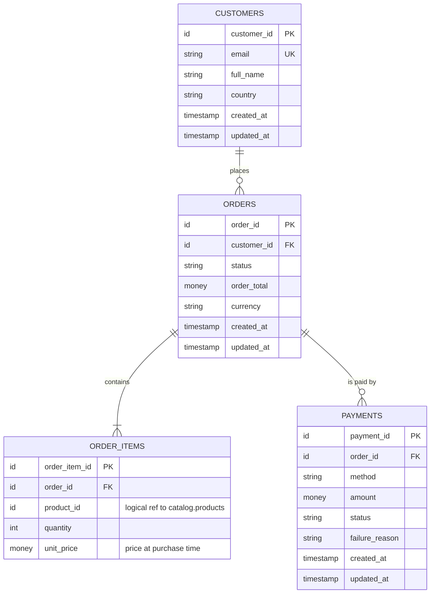
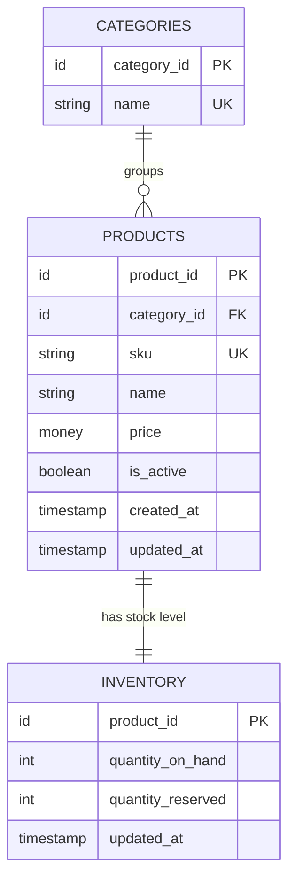
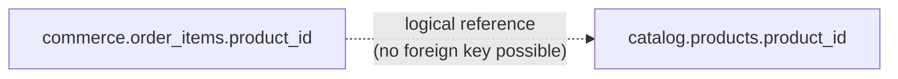

# Operational Data Model

This document describes the **conceptual and logical** model of OmniCommerce's operational (OLTP) data: which entities exist, how they relate, and which system owns them.

Physical details (exact column types, constraints, indexes) are designed in [Milestone 1 · Day 2](../milestones/01-foundations/README.md) and live in `databases/*/`.

---

## 1. Ownership

OmniCommerce runs two independently owned operational databases. Each fictional team owns its database and is the only writer to it. See [ADR-0001](../decisions/0001-two-independent-operational-databases.md) for the reasoning.

| Entity | Owner (fictional team) | System | Database | Written by |
|---|---|---|---|---|
| `customers` | Commerce team | PostgreSQL 16 | `commerce` | Checkout / account service (simulated by the data generator) |
| `orders` | Commerce team | PostgreSQL 16 | `commerce` | Checkout service |
| `order_items` | Commerce team | PostgreSQL 16 | `commerce` | Checkout service |
| `payments` | Commerce team | PostgreSQL 16 | `commerce` | Payment service |
| `categories` | Catalog team | MySQL 8.4 | `catalog` | Catalog admin tool |
| `products` | Catalog team | MySQL 8.4 | `catalog` | Catalog admin tool |
| `inventory` | Catalog team | MySQL 8.4 | `catalog` | Warehouse / inventory service |

Non-database sources are added later and are not part of this model:

| Source | Owner | Arrives in |
|---|---|---|
| Marketing campaigns and campaign metrics (REST API) | Marketing team | M1 · Day 5 |
| Historical exports (CSV / JSON files) | Finance / legacy systems | M1 · Day 5 |
| Clickstream and app events | Web & mobile teams | M3 |
| Application logs | Platform team | M3 |

---

## 2. Entity Relationship Diagram

Attribute types are **logical** (`id`, `money`, `timestamp`); physical types are chosen on Day 2.

### `commerce` database (PostgreSQL)

### `catalog` database (MySQL)

### Cross-database relationship

---

## 3. Relationship Rules

| Relationship | Cardinality | Why |
|---|---|---|
| customer → orders | 1 to 0..N | A new customer may not have ordered yet. |
| order → order_items | 1 to 1..N | An order without items is invalid. |
| order → payments | 1 to 0..N | An order exists before payment; a failed attempt can be followed by a retry, so one order can have several payment rows. |
| category → products | 1 to 0..N | Flat categories for now (no hierarchy). |
| product → inventory | 1 to 1 | One stock row per product (single warehouse for now). |
| order_item → product | N to 1, **across databases** | Enforced by the application and checked by validation, not by the database. |

---

## 4. Conventions

- **Time:** all timestamps are stored in UTC. PostgreSQL uses `timestamptz` and the database timezone is set to `UTC` in `001_init.sql`; MySQL runs with `--default-time-zone=+00:00`.
- **Change tracking:** every mutable table has `created_at` and `updated_at`. Incremental ingestion (M2) depends on `updated_at`.
- **Money:** exact decimal types, never floating point. Each order carries a `currency`.
- **Price snapshot:** `order_items.unit_price` stores the price at purchase time. Later catalog price changes must not rewrite order history.
- **Status values:** order and payment statuses come from a fixed list, defined on Day 2 and Day 4.
- **Init history:** each database has a `schema_migrations` table that records which init scripts have been applied.

---

## 5. Known Consistency Challenges (intentional)

Splitting ownership across two databases creates problems that later milestones must handle:

1. **No cross-database foreign key.** An `order_items.product_id` can point to a product that never existed or was deleted. → detected by validation (Day 6).
2. **No shared transaction.** Creating an order (PostgreSQL) and reserving stock (MySQL) cannot be atomic. A crash between the two leaves them inconsistent, and concurrent orders can oversell. → explored on Days 4 and 8; patterns such as the outbox and sagas come later.
3. **Different clocks and change logs.** Each database has its own WAL / binlog. Joining their changes requires care with ordering and time. → M2 (CDC) and M5 (stream processing).
4. **Hard deletes.** Deleted products disappear from query-based incremental ingestion. → M2.

---

## 6. Open Design Questions (to decide on Day 2)

- Surrogate key type: `BIGINT` identity vs UUID.
- Soft delete (`is_active` / `deleted_at`) vs hard delete for products.
- Whether `orders.order_total` is stored or always derived from `order_items`.
