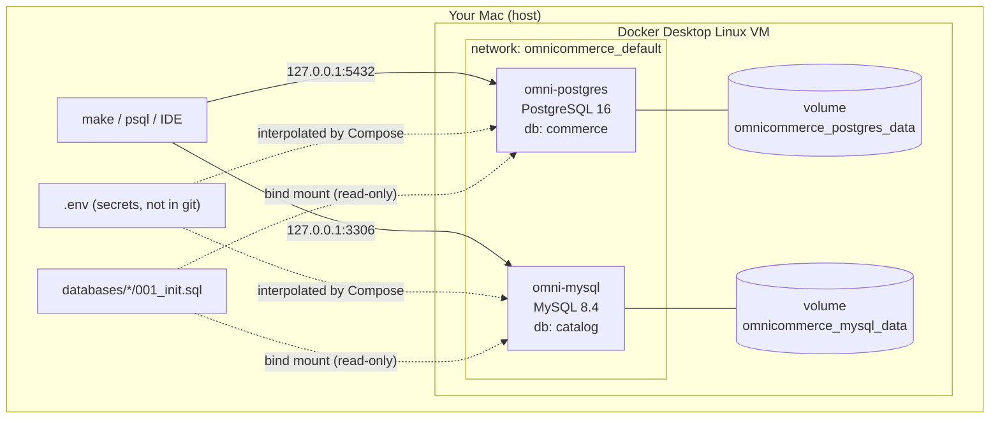

# Day 1 — Project Setup, Docker Compose & Data Architecture

> 🇻🇳 Vietnamese version: [day-01-setup.vi.md](day-01-setup.vi.md) · ⬅ [Milestone 1 index](README.md)

**Time:** 3–5 hours · **Difficulty:** Beginner

By the end of today you will have two independently owned operational databases running locally, verified to be healthy, reachable, and persistent, plus the first data model and architecture decision for the platform.

---

## 1. Learning Objectives

After this day you should be able to:

1. Explain the difference between **OLTP** and **OLAP** systems and why a data platform starts from OLTP sources.
2. Explain **images, containers, named volumes, bind mounts, and port publishing** in Docker.
3. Read and debug a **Docker Compose** file, including `.env` interpolation (`$` vs `$$`).
4. Describe **exactly when** the PostgreSQL and MySQL images run initialization scripts, and the consequences.
5. Write **healthchecks** that do not report "healthy" too early.
6. Prove that data survives container recreation.
7. Explain **database ownership** and why OmniCommerce uses two separate databases.

---

## 2. Prerequisites

| Tool | Check | Notes |
|---|---|---|
| Docker Desktop (or compatible) | `docker --version`, `docker compose version` | Compose v2 (`docker compose`, not `docker-compose`). Allocate at least 4 GB RAM. |
| Git | `git --version` | |
| make | `make --version` | Preinstalled on macOS with Xcode Command Line Tools. |
| `psql` (optional) | `psql --version` | macOS: `brew install libpq` (client only). Used to connect from the host. |
| `mysql` client (optional) | `mysql --version` | macOS: `brew install mysql-client`. Without it, connect from inside the container. |

**Resources measured on 2026-10-15 (Apple Silicon, Docker Desktop, idle, empty databases):**

| | Image size | Idle memory | Volume size |
|---|---|---|---|
| PostgreSQL 16 | 657 MB | ~21 MiB | ~48 MB |
| MySQL 8.4 | 1.1 GB | ~431 MiB | ~218 MB |

MySQL uses far more memory and disk at idle. InnoDB reserves its buffer pool, Performance Schema allocates memory, and the data directory includes redo/undo logs and the binary log. Your numbers may differ.

---

## 3. Core Concepts

### 3.1 OLTP vs OLAP

| | OLTP (operational) | OLAP (analytical) |
|---|---|---|
| Purpose | Run the business: place an order, take a payment | Understand the business: revenue per month |
| Typical query | Read/write a few rows by key | Scan and aggregate millions of rows |
| Data shape | Normalized, current state | Denormalized, historical |
| Storage layout | Row-oriented | Usually column-oriented |
| Examples | PostgreSQL, MySQL | ClickHouse, Trino over Iceberg, Snowflake |

A data platform exists because running analytics directly on OLTP databases is risky: heavy queries slow down the application, data is spread across systems, and history is overwritten by updates. Today we build the **OLTP side**. Everything after Milestone 1 moves this data into OLAP-friendly systems.

### 3.2 Docker building blocks

- **Image** — a read-only template (`postgres:16`). Pulled once, reused.
- **Container** — a running instance of an image with its own writable layer. **Deleting a container deletes its writable layer.**
- **Named volume** — storage managed by Docker (`postgres_data`), independent of any container. This is where database files must live.
- **Bind mount** — a file or directory from your machine mounted into the container (`../../databases/postgres/001_init.sql`). Good for configuration and scripts.
- **Port publishing** — `"127.0.0.1:5432:5432"` forwards host port 5432 on the loopback interface only to container port 5432. Without the `127.0.0.1:` prefix, the database would be reachable from every network your laptop joins.
- **Network** — Compose creates a private network (`omnicommerce_default`) where services reach each other by service name (`postgres`, `mysql`).

### 3.3 Database ownership

Each fictional team owns one database and is its only writer:

- **Commerce team → PostgreSQL `commerce`:** customers, orders, order items, payments.
- **Catalog team → MySQL `catalog`:** categories, products, inventory.

The split removes cross-database foreign keys and transactions. That is deliberate: it reproduces the integration problems real data platforms solve. See [ADR-0001](../../decisions/0001-two-independent-operational-databases.md).

---

## 4. Architecture Explanation



On macOS, containers run inside a lightweight Linux VM managed by Docker Desktop. Named volumes live **inside that VM**, not in your project folder. Port publishing is how traffic crosses from macOS into the VM.

The data model for both databases is in [docs/architecture/data-model.md](../../architecture/data-model.md).

---

## 5. Hands-on Implementation

All commands run from the repository root.

### Step 1 — Configure environment variables

```bash
make env          # copies .env.example to .env if it does not exist
```

Open `.env` and change the passwords. `.env` is listed in `.gitignore`; confirm with:

```bash
git check-ignore -v .env
# .gitignore:2:.env	.env
```

### Step 2 — Read the Compose file

Open [`infrastructure/docker/compose.yml`](../../../infrastructure/docker/compose.yml). Key lines:

| Line(s) | Meaning |
|---|---|
| `name: omnicommerce` | Project name; prefixes networks and volumes (`omnicommerce_postgres_data`). |
| `${POSTGRES_USER}` | Replaced by Compose **when it reads the file**, using `.env`. |
| `$$POSTGRES_USER` | `$$` escapes to a literal `$`, so the variable is expanded **inside the container** at runtime. |
| `"127.0.0.1:5432:5432"` | Publish on loopback only. |
| `postgres_data:/var/lib/postgresql/data` | Named volume for database files. No space after `:` — with a space, YAML parses it as a mapping. |
| `…/001_init.sql:/docker-entrypoint-initdb.d/001_init.sql:ro` | Bind-mount the init script read-only. |
| `healthcheck` with `-h 127.0.0.1` | Checks over TCP (see Under the Hood). |
| `stop_grace_period: 60s` | Gives MySQL time to shut down cleanly before Docker sends SIGKILL. |
| `--default-time-zone=+00:00` | MySQL session time zone defaults to UTC. |

Validate it:

```bash
make config
# compose.yml is valid
```

### Step 3 — Read the init scripts

- [`databases/postgres/001_init.sql`](../../../databases/postgres/001_init.sql): sets the database timezone to UTC and creates `schema_migrations`.
- [`databases/mysql/001_init.sql`](../../../databases/mysql/001_init.sql): creates `schema_migrations`.

`schema_migrations` records which init scripts ran. Real migration tools (Flyway, Alembic, Liquibase) keep the same kind of history table. Business tables come on Day 2.

### Step 4 — Start the databases

```bash
make up           # docker compose up -d --wait
make ps
```

Expected output (from a real run; IDs and times will differ):

```text
NAME            IMAGE         STATUS                   PORTS
omni-mysql      mysql:8.4     Up 5 seconds (healthy)   127.0.0.1:3306->3306/tcp
omni-postgres   postgres:16   Up 5 seconds (healthy)   127.0.0.1:5432->5432/tcp
```

`--wait` blocks until both healthchecks pass, or fails if they never do.

Confirm the init scripts ran:

```bash
make logs s=postgres   # look for: running /docker-entrypoint-initdb.d/001_init.sql
make logs s=mysql      # look for: MySQL init process done. Ready for start up.
```

### Step 5 — Connect from inside the containers

```bash
make psql
```

```sql
SELECT * FROM schema_migrations;
SHOW timezone;           -- UTC
\q
```

```bash
make mysql
```

```sql
SELECT * FROM schema_migrations;
SELECT @@global.time_zone, @@character_set_server, @@log_bin, @@binlog_format;
-- +00:00 | utf8mb4 | 1 | ROW
exit
```

Notice `@@log_bin = 1` and `binlog_format = ROW`. MySQL 8.4 writes a row-based binary log by default. Debezium will read this log for CDC in Milestone 2.

### Step 6 — Connect from the host

```bash
set -a; . ./.env; set +a          # load .env into this shell only
PGPASSWORD="$POSTGRES_PASSWORD" psql -h 127.0.0.1 -U "$POSTGRES_USER" -d "$POSTGRES_DB" \
  -c "select current_user, current_database(), inet_server_addr();"
```

Expected (real run):

```text
 current_user | current_database | inet_server_addr
--------------+------------------+------------------
 omni         | commerce         | 172.18.0.3
```

`inet_server_addr()` is the container's IP on the Docker network, not `127.0.0.1`. Docker forwarded your connection into the container.

For MySQL, with the client installed: `mysql -h 127.0.0.1 -u "$MYSQL_USER" -p "$MYSQL_DATABASE"`. Without it, at least check the port: `nc -zv 127.0.0.1 3306`.

**Security check:** the ports must not be reachable from your LAN IP:

```bash
nc -z -G 2 "$(ipconfig getifaddr en0)" 5432 && echo "EXPOSED" || echo "not reachable (good)"
```

### Step 7 — Prove persistence

```bash
make psql   # then:  CREATE TABLE persistence_check(note text); INSERT INTO persistence_check VALUES ('before down');
make down   # removes the containers (volumes are kept)
docker ps -a --filter name=omni-     # nothing listed
docker volume ls --filter name=omnicommerce   # both volumes still exist
make up
make psql   # SELECT * FROM persistence_check;  -> 'before down'
            # SELECT count(*) FROM schema_migrations; -> 1 (init did NOT run again)
            # DROP TABLE persistence_check;
```

The container is new (different ID), but the data survived because it lives in the volume.

### Step 8 — Data model and decision record

Read and review:

- [Operational data model and ERD](../../architecture/data-model.md)
- [ADR-0001: Two independent operational databases](../../decisions/0001-two-independent-operational-databases.md)

---

## 6. Under the Hood

### What the entrypoint does on first start

Both official images ship a `docker-entrypoint.sh`. On start it checks whether the data directory is empty:

```text
data dir empty?
 ├─ yes → initialize data files (initdb / mysqld --initialize)
 │        start a TEMPORARY server (no TCP: socket only)
 │        create the user and database from env vars
 │        run /docker-entrypoint-initdb.d/* in alphabetical order
 │        stop the temporary server
 │        start the REAL server (TCP enabled)
 └─ no  → "Skipping initialization" → start the real server
```

Consequences:

- Init scripts run **once per volume**. Editing them later does nothing until you `make reset`.
- `POSTGRES_PASSWORD`, `MYSQL_PASSWORD`, etc. are applied **only at initialization**. Changing them in `.env` later does not change the real password.
- If a script fails halfway, the data directory is already non-empty, so the next start skips init and you are left with a half-initialized database. Fix: correct the script, then `make reset && make up`.

### Why the healthcheck uses `127.0.0.1`

During initialization the temporary server listens only on a Unix socket. The MySQL logs show `port: 0`. `pg_isready` and `mysqladmin ping` default to the socket, so they can succeed **while init scripts are still running**. Dependent services would then connect too early. Forcing TCP with `-h 127.0.0.1` means the check passes only once the real server is up.

`MYSQL_PWD` passes the password through an environment variable instead of `-p<password>`, which would be visible in the process list and triggers a warning.

### `$` vs `$$` in Compose

```yaml
POSTGRES_USER: ${POSTGRES_USER}                       # Compose substitutes from .env at parse time
test: ["CMD-SHELL", "pg_isready -U $$POSTGRES_USER"]  # literal $POSTGRES_USER, expanded by the container's shell
```

The `.env` file is read from the **project directory** (the folder of the Compose file) unless you pass `--env-file`. That is why the Makefile always passes `--env-file .env`.

### Exit codes

`137 = 128 + 9` means the process was killed with SIGKILL. `docker stop` sends SIGTERM, waits for the grace period (10 s by default), then sends SIGKILL. A database killed this way must run crash recovery on the next start. With the current setup, `docker compose stop mysql` finished in about 1 s with exit code 0. `stop_grace_period: 60s` is a safety margin for larger buffer pools.

### Where the volume actually is

```bash
docker volume inspect omnicommerce_postgres_data --format '{{ .Mountpoint }}'
# /var/lib/docker/volumes/omnicommerce_postgres_data/_data   (inside the Docker Desktop VM)
```

You cannot `ls` this path from macOS. That is fine: treat volumes as opaque and use database tools (`pg_dump`, `mysqldump`) for backups.

---

## 7. Break & Fix Exercises

Do each exercise, observe the symptom, explain the root cause, then restore a working state. Commands that delete volumes only delete local test data.

### Exercise A — The missing init file

1. `make reset`
2. `mv databases/postgres/001_init.sql /tmp/`
3. `make up` — observe the result, then run `ls -la databases/postgres/`.
4. `make logs s=postgres` — find the error.

**Questions:** What did Docker create at the missing path, and why? After you move the file back, why does `make up` alone not fix the database?

**Fix:** `make down`, remove the directory Docker created, restore the file, `make reset && make up`.

### Exercise B — Editing an init script too late

1. Add `CREATE TABLE day1_test(id int);` to `databases/postgres/001_init.sql`.
2. `make down && make up`, then `make psql` → `\dt`.

**Question:** Is `day1_test` there? What is the minimum command sequence that makes it appear? Remove the line afterwards.

### Exercise C — Rotating a password the wrong way

1. Change `POSTGRES_PASSWORD` in `.env`.
2. `make down && make up` → is it healthy?
3. Connect from the host with the new password (Step 6).

**Questions:** Why does the healthcheck still pass while the host login fails? How would you change a password correctly on an existing database (`ALTER USER …`)? Restore the original value.

### Exercise D — YAML indentation

1. Indent the `mysql:` block by two extra spaces so it sits under `postgres:`.
2. `make config` → read the error.

**Question:** Which key does Compose say is duplicated, and why? (This is the first bug this project hit.)

### Exercise E — Port conflict

1. Start a second PostgreSQL bound to the same port:
   `docker run --rm -d --name pg-conflict -p 127.0.0.1:5432:5432 -e POSTGRES_PASSWORD=x postgres:16`
2. Read the error. Remove it with `docker rm -f pg-conflict`.

**Question:** A Homebrew PostgreSQL service running on your Mac causes the same conflict, but sometimes silently: your `psql` connects to the wrong server. How would you detect that? (Hint: Step 6.)

---

## 8. Knowledge Check

<details>
<summary>1. Why must database files live in a named volume rather than the container's filesystem?</summary>

The container's writable layer is deleted with the container (`make down`, image upgrades, `docker rm`). A named volume has its own lifecycle and is reattached to the new container.
</details>

<details>
<summary>2. You add a table to 001_init.sql and run <code>docker compose restart</code>. Does the table appear?</summary>

No. The entrypoint runs init scripts only when the data directory is empty. Restart keeps the same volume, so init is skipped. You need `make reset && make up`. That destroys data, which is why real systems use migrations instead.
</details>

<details>
<summary>3. What is the difference between <code>5432:5432</code> and <code>127.0.0.1:5432:5432</code>?</summary>

The first binds to all host interfaces (`0.0.0.0`), so anyone on the same network can try to connect. The second binds only to loopback, so only processes on your machine can connect.
</details>

<details>
<summary>4. Why can a healthcheck that uses the Unix socket report "healthy" too early?</summary>

During initialization the image runs a temporary server that listens only on the socket. A socket-based check succeeds against that temporary server while init scripts are still running.
</details>

<details>
<summary>5. Why can't <code>order_items.product_id</code> have a foreign key to <code>products</code>?</summary>

They live in different database servers (PostgreSQL and MySQL). Foreign keys and transactions cannot span database servers, so integrity has to be checked by the application and by downstream validation.
</details>

<details>
<summary>6. Why does a data platform not just run analytical queries directly on the OLTP databases?</summary>

Heavy scans compete with the application for CPU, memory, I/O, and locks. Data is split across systems that cannot be joined directly. Updates overwrite history. OLTP storage and indexing are optimized for point reads and writes, not large aggregations.
</details>

---

## 9. Challenges

**Basic**

1. Add a `make versions` target that prints the PostgreSQL and MySQL server versions.
2. Run `docker stats` while both databases are idle, and record their memory use in the learning log. Explain why MySQL uses more.
3. Add `databases/postgres/002_comment.sql` that inserts version `002` into `schema_migrations`. Prove the scripts run in alphabetical order.

**Advanced**

1. Make the PostgreSQL healthcheck stricter: report healthy only if `schema_migrations` contains version `001`. What are the trade-offs of a "deep" healthcheck?
2. Time `make reset && make up` five times. Where does most of the startup time go? (Hint: compare timestamps in the logs.)
3. Replace the named volume with a bind mount to `./data/pg` for PostgreSQL in a scratch branch. What breaks or gets slower on macOS, and why do official images recommend named volumes?

---

## 10. Definition of Done

- [ ] `make config` reports the Compose file is valid.
- [ ] `make up` finishes with both containers `healthy`.
- [ ] Logs show both `001_init.sql` scripts ran without errors.
- [ ] `schema_migrations` contains version `001` in both databases.
- [ ] PostgreSQL timezone is `UTC`; MySQL `@@global.time_zone` is `+00:00`.
- [ ] Connection works from inside the containers and from the host.
- [ ] Ports are not reachable from the LAN IP.
- [ ] Persistence test passes (`down` → `up` keeps data, init does not re-run).
- [ ] `.env` is ignored by git.
- [ ] You can explain the ERD, the ownership table, and ADR-0001 in your own words.
- [ ] Break & Fix exercises A–C completed.
- [ ] Learning log entry written in [docs/roadmap.md](../../roadmap.md).

---

## 11. Further Reading

- [Docker Official Image: postgres — "Initialization scripts"](https://hub.docker.com/_/postgres)
- [Docker Official Image: mysql — "Initializing a fresh instance"](https://hub.docker.com/_/mysql)
- [Docker docs — Volumes](https://docs.docker.com/engine/storage/volumes/) and [Bind mounts](https://docs.docker.com/engine/storage/bind-mounts/)
- [Compose file reference — healthcheck, stop_grace_period](https://docs.docker.com/reference/compose-file/services/)
- [Compose — Interpolation of environment variables](https://docs.docker.com/compose/how-tos/environment-variables/variable-interpolation/)
- [PostgreSQL — pg_isready](https://www.postgresql.org/docs/16/app-pg-isready.html)
- [MySQL 8.4 — Time Zone Support](https://dev.mysql.com/doc/refman/8.4/en/time-zone-support.html)
- Martin Kleppmann, *Designing Data-Intensive Applications*, Chapter 1 (reliability, scalability, maintainability) and Chapter 3 (OLTP vs OLAP storage).
