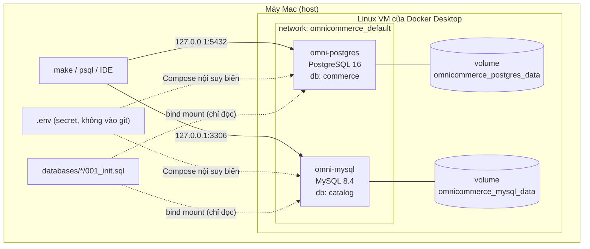

# Ngày 1 — Thiết lập dự án, Docker Compose & Kiến trúc dữ liệu

> 🇬🇧 English version: [day-01-setup.md](day-01-setup.md) · ⬅ [Mục lục Milestone 1](README.md)

**Thời gian:** 3–5 giờ · **Độ khó:** Cơ bản

Cuối ngày hôm nay bạn sẽ có hai database vận hành thuộc sở hữu độc lập, chạy trên máy local, đã kiểm chứng là healthy, kết nối được và giữ được dữ liệu. Kèm theo đó là mô hình dữ liệu và quyết định kiến trúc đầu tiên của nền tảng.

---

## 1. Mục tiêu học

Sau ngày này bạn có thể:

1. Giải thích khác biệt giữa hệ thống **OLTP** và **OLAP**, và vì sao một nền tảng dữ liệu bắt đầu từ nguồn OLTP.
2. Giải thích **image, container, named volume, bind mount và publish port** trong Docker.
3. Đọc và debug file **Docker Compose**, bao gồm cách nội suy biến từ `.env` (`$` vs `$$`).
4. Mô tả **chính xác khi nào** image PostgreSQL và MySQL chạy init script, và hệ quả của điều đó.
5. Viết **healthcheck** không báo "healthy" quá sớm.
6. Chứng minh dữ liệu vẫn còn sau khi container bị tạo lại.
7. Giải thích **quyền sở hữu database** và vì sao OmniCommerce dùng hai database riêng.

---

## 2. Điều kiện tiên quyết

| Công cụ | Kiểm tra | Ghi chú |
|---|---|---|
| Docker Desktop (hoặc tương đương) | `docker --version`, `docker compose version` | Compose v2 (`docker compose`, không phải `docker-compose`). Cấp ít nhất 4 GB RAM. |
| Git | `git --version` | |
| make | `make --version` | Có sẵn trên macOS khi cài Xcode Command Line Tools. |
| `psql` (tuỳ chọn) | `psql --version` | macOS: `brew install libpq` (chỉ client). Dùng để kết nối từ host. |
| `mysql` client (tuỳ chọn) | `mysql --version` | macOS: `brew install mysql-client`. Không có thì kết nối từ trong container. |

**Tài nguyên đo thật ngày 2026-10-15 (Apple Silicon, Docker Desktop, lúc rảnh, database trống):**

| | Kích thước image | RAM lúc rảnh | Kích thước volume |
|---|---|---|---|
| PostgreSQL 16 | 657 MB | ~21 MiB | ~48 MB |
| MySQL 8.4 | 1.1 GB | ~431 MiB | ~218 MB |

Lúc rảnh, MySQL dùng nhiều RAM và ổ đĩa hơn hẳn. Lý do: InnoDB giữ sẵn buffer pool, Performance Schema cấp phát bộ nhớ, và thư mục dữ liệu chứa cả redo/undo log lẫn binary log. Số liệu trên máy bạn có thể khác.

---

## 3. Khái niệm cốt lõi

### 3.1 OLTP vs OLAP

| | OLTP (vận hành) | OLAP (phân tích) |
|---|---|---|
| Mục đích | Vận hành doanh nghiệp: đặt đơn, nhận thanh toán | Hiểu doanh nghiệp: doanh thu theo tháng |
| Query điển hình | Đọc/ghi vài dòng theo khoá | Quét và tổng hợp hàng triệu dòng |
| Hình dạng dữ liệu | Chuẩn hoá, trạng thái hiện tại | Phi chuẩn hoá, có lịch sử |
| Cách lưu trữ | Theo dòng | Thường theo cột |
| Ví dụ | PostgreSQL, MySQL | ClickHouse, Trino trên Iceberg, Snowflake |

Nền tảng dữ liệu tồn tại vì chạy phân tích trực tiếp trên database OLTP rất rủi ro: query nặng làm chậm ứng dụng, dữ liệu nằm rải rác ở nhiều hệ thống, và lịch sử bị ghi đè mỗi khi update. Hôm nay ta xây **phía OLTP**. Mọi thứ sau Milestone 1 là đưa dữ liệu này sang các hệ thống phù hợp cho OLAP.

### 3.2 Các khối cơ bản của Docker

- **Image** — khuôn mẫu chỉ đọc (`postgres:16`). Tải một lần, dùng lại nhiều lần.
- **Container** — một instance đang chạy của image, có lớp ghi riêng. **Xoá container là xoá lớp ghi đó.**
- **Named volume** — vùng lưu trữ do Docker quản lý (`postgres_data`), độc lập với mọi container. File database phải nằm ở đây.
- **Bind mount** — một file hoặc thư mục trên máy bạn được gắn vào container (`../../databases/postgres/001_init.sql`). Phù hợp cho cấu hình và script.
- **Publish port** — `"127.0.0.1:5432:5432"` chuyển tiếp port 5432 của host, chỉ trên interface loopback, vào port 5432 của container. Nếu thiếu tiền tố `127.0.0.1:`, database sẽ truy cập được từ mọi mạng mà laptop bạn kết nối.
- **Network** — Compose tạo một mạng riêng (`omnicommerce_default`), trong đó các service gọi nhau bằng tên service (`postgres`, `mysql`).

### 3.3 Quyền sở hữu database

Mỗi team giả định sở hữu một database và là bên duy nhất được ghi vào đó:

- **Team Commerce → PostgreSQL `commerce`:** khách hàng, đơn hàng, chi tiết đơn hàng, thanh toán.
- **Team Catalog → MySQL `catalog`:** danh mục, sản phẩm, tồn kho.

Việc tách đôi này làm mất foreign key và transaction xuyên database. Đây là cố ý: nó tái hiện đúng các bài toán tích hợp mà nền tảng dữ liệu thực tế phải giải quyết. Xem [ADR-0001](../../decisions/0001-two-independent-operational-databases.md).

---

## 4. Giải thích kiến trúc



Trên macOS, container chạy bên trong một Linux VM nhẹ do Docker Desktop quản lý. Named volume nằm **bên trong VM đó**, không nằm trong thư mục dự án. Publish port là cách để traffic đi từ macOS vào VM.

Mô hình dữ liệu của cả hai database nằm ở [docs/architecture/data-model.md](../../architecture/data-model.md).

---

## 5. Thực hành

Mọi lệnh đều chạy từ thư mục gốc của repository.

### Bước 1 — Cấu hình biến môi trường

```bash
make env          # copy .env.example thành .env nếu chưa có
```

Mở `.env` và đổi mật khẩu. `.env` đã nằm trong `.gitignore`; xác nhận bằng:

```bash
git check-ignore -v .env
# .gitignore:2:.env	.env
```

### Bước 2 — Đọc file Compose

Mở [`infrastructure/docker/compose.yml`](../../../infrastructure/docker/compose.yml). Các dòng quan trọng:

| Dòng | Ý nghĩa |
|---|---|
| `name: omnicommerce` | Tên project; làm tiền tố cho network và volume (`omnicommerce_postgres_data`). |
| `${POSTGRES_USER}` | Compose thay giá trị **ngay khi đọc file**, lấy từ `.env`. |
| `$$POSTGRES_USER` | `$$` được escape thành `$` thường, nên biến được thay **bên trong container** lúc chạy. |
| `"127.0.0.1:5432:5432"` | Chỉ publish trên loopback. |
| `postgres_data:/var/lib/postgresql/data` | Named volume chứa file database. Không có dấu cách sau `:` — nếu có, YAML sẽ hiểu thành một mapping. |
| `…/001_init.sql:/docker-entrypoint-initdb.d/001_init.sql:ro` | Bind mount init script ở chế độ chỉ đọc. |
| `healthcheck` với `-h 127.0.0.1` | Kiểm tra qua TCP (xem phần Bên dưới lớp vỏ). |
| `stop_grace_period: 60s` | Cho MySQL đủ thời gian tắt sạch trước khi Docker gửi SIGKILL. |
| `--default-time-zone=+00:00` | Múi giờ mặc định của MySQL là UTC. |

Kiểm tra file:

```bash
make config
# compose.yml is valid
```

### Bước 3 — Đọc init script

- [`databases/postgres/001_init.sql`](../../../databases/postgres/001_init.sql): đặt timezone của database là UTC và tạo bảng `schema_migrations`.
- [`databases/mysql/001_init.sql`](../../../databases/mysql/001_init.sql): tạo bảng `schema_migrations`.

`schema_migrations` ghi lại những init script nào đã chạy. Các công cụ migration thật (Flyway, Alembic, Liquibase) cũng giữ một bảng lịch sử tương tự. Các bảng nghiệp vụ sẽ có ở Ngày 2.

### Bước 4 — Khởi động database

```bash
make up           # docker compose up -d --wait
make ps
```

Kết quả mong đợi (từ một lần chạy thật; ID và thời gian sẽ khác):

```text
NAME            IMAGE         STATUS                   PORTS
omni-mysql      mysql:8.4     Up 5 seconds (healthy)   127.0.0.1:3306->3306/tcp
omni-postgres   postgres:16   Up 5 seconds (healthy)   127.0.0.1:5432->5432/tcp
```

`--wait` chờ đến khi cả hai healthcheck pass, hoặc báo lỗi nếu không bao giờ pass.

Xác nhận init script đã chạy:

```bash
make logs s=postgres   # tìm dòng: running /docker-entrypoint-initdb.d/001_init.sql
make logs s=mysql      # tìm dòng: MySQL init process done. Ready for start up.
```

### Bước 5 — Kết nối từ trong container

```bash
make psql
```

```sql
SELECT * FROM schema_migrations;
SHOW timezone;           -- UTC
\q
```

```bash
make mysql
```

```sql
SELECT * FROM schema_migrations;
SELECT @@global.time_zone, @@character_set_server, @@log_bin, @@binlog_format;
-- +00:00 | utf8mb4 | 1 | ROW
exit
```

Để ý `@@log_bin = 1` và `binlog_format = ROW`. Mặc định MySQL 8.4 đã ghi binary log theo dạng row. Ở Milestone 2, Debezium sẽ đọc log này để làm CDC.

### Bước 6 — Kết nối từ host

```bash
set -a; . ./.env; set +a          # nạp .env vào riêng shell này
PGPASSWORD="$POSTGRES_PASSWORD" psql -h 127.0.0.1 -U "$POSTGRES_USER" -d "$POSTGRES_DB" \
  -c "select current_user, current_database(), inet_server_addr();"
```

Kết quả mong đợi (chạy thật):

```text
 current_user | current_database | inet_server_addr
--------------+------------------+------------------
 omni         | commerce         | 172.18.0.3
```

`inet_server_addr()` trả về IP của container trong mạng Docker, không phải `127.0.0.1`. Docker đã chuyển tiếp kết nối của bạn vào container.

Với MySQL, nếu đã cài client: `mysql -h 127.0.0.1 -u "$MYSQL_USER" -p "$MYSQL_DATABASE"`. Nếu chưa có client, ít nhất hãy kiểm tra port: `nc -zv 127.0.0.1 3306`.

**Kiểm tra bảo mật:** port không được phép truy cập từ IP LAN của máy:

```bash
nc -z -G 2 "$(ipconfig getifaddr en0)" 5432 && echo "EXPOSED" || echo "not reachable (good)"
```

### Bước 7 — Chứng minh dữ liệu được giữ lại

```bash
make psql   # rồi chạy:  CREATE TABLE persistence_check(note text); INSERT INTO persistence_check VALUES ('before down');
make down   # xoá container (volume được giữ lại)
docker ps -a --filter name=omni-     # không còn container nào
docker volume ls --filter name=omnicommerce   # cả hai volume vẫn còn
make up
make psql   # SELECT * FROM persistence_check;  -> 'before down'
            # SELECT count(*) FROM schema_migrations; -> 1 (init KHÔNG chạy lại)
            # DROP TABLE persistence_check;
```

Container là container mới (ID khác), nhưng dữ liệu vẫn còn vì nó nằm trong volume.

### Bước 8 — Mô hình dữ liệu và ADR

Đọc và rà lại:

- [Mô hình dữ liệu vận hành và ERD](../../architecture/data-model.md)
- [ADR-0001: Hai database vận hành độc lập](../../decisions/0001-two-independent-operational-databases.md)

---

## 6. Bên dưới lớp vỏ

### Entrypoint làm gì ở lần khởi động đầu tiên

Cả hai image chính thức đều có script `docker-entrypoint.sh`. Khi khởi động, nó kiểm tra thư mục dữ liệu có trống không:

```text
thư mục dữ liệu trống?
 ├─ có   → khởi tạo file dữ liệu (initdb / mysqld --initialize)
 │         chạy một server TẠM (không TCP, chỉ socket)
 │         tạo user và database từ biến môi trường
 │         chạy /docker-entrypoint-initdb.d/* theo thứ tự chữ cái
 │         tắt server tạm
 │         chạy server THẬT (bật TCP)
 └─ không → "Skipping initialization" → chạy server thật
```

Hệ quả:

- Init script chỉ chạy **một lần cho mỗi volume**. Sửa script về sau không có tác dụng cho đến khi bạn chạy `make reset`.
- `POSTGRES_PASSWORD`, `MYSQL_PASSWORD`, … **chỉ được áp dụng lúc khởi tạo**. Đổi chúng trong `.env` về sau không đổi mật khẩu thật.
- Nếu script lỗi giữa chừng, thư mục dữ liệu đã không còn trống, nên lần sau entrypoint bỏ qua init và bạn bị kẹt với một database khởi tạo dở. Cách sửa: sửa script, rồi `make reset && make up`.

### Vì sao healthcheck dùng `127.0.0.1`

Trong lúc khởi tạo, server tạm chỉ lắng nghe trên Unix socket; log MySQL ghi `port: 0`. Mặc định `pg_isready` và `mysqladmin ping` kết nối qua socket, nên chúng có thể thành công **khi init script vẫn đang chạy**. Các service phụ thuộc khi đó sẽ kết nối quá sớm. Ép dùng TCP bằng `-h 127.0.0.1` đảm bảo check chỉ pass khi server thật đã chạy.

`MYSQL_PWD` truyền mật khẩu qua biến môi trường thay vì `-p<password>`. Cách sau lộ mật khẩu trong danh sách process và còn sinh cảnh báo.

### `$` vs `$$` trong Compose

```yaml
POSTGRES_USER: ${POSTGRES_USER}                       # Compose thay giá trị từ .env lúc đọc file
test: ["CMD-SHELL", "pg_isready -U $$POSTGRES_USER"]  # thành $POSTGRES_USER, do shell trong container thay
```

File `.env` được đọc từ **thư mục project** (thư mục chứa file Compose), trừ khi bạn truyền `--env-file`. Vì vậy Makefile luôn truyền `--env-file .env`.

### Exit code

`137 = 128 + 9` nghĩa là process bị kill bằng SIGKILL. `docker stop` gửi SIGTERM, chờ hết thời gian ân hạn (mặc định 10 giây), rồi mới gửi SIGKILL. Database bị kill kiểu này phải chạy crash recovery ở lần khởi động sau. Với cấu hình hiện tại, `docker compose stop mysql` xong trong khoảng 1 giây với exit code 0. `stop_grace_period: 60s` là biên an toàn khi buffer pool lớn hơn.

### Volume thực sự nằm ở đâu

```bash
docker volume inspect omnicommerce_postgres_data --format '{{ .Mountpoint }}'
# /var/lib/docker/volumes/omnicommerce_postgres_data/_data   (bên trong VM của Docker Desktop)
```

Bạn không thể `ls` đường dẫn này từ macOS. Điều đó không sao: hãy coi volume là hộp đen và dùng công cụ của database (`pg_dump`, `mysqldump`) để backup.

---

## 7. Bài tập Phá & Sửa

Với mỗi bài: làm theo, quan sát triệu chứng, giải thích nguyên nhân gốc, rồi khôi phục trạng thái hoạt động. Các lệnh xoá volume chỉ xoá dữ liệu test trên máy local.

### Bài A — Thiếu file init

1. `make reset`
2. `mv databases/postgres/001_init.sql /tmp/`
3. `make up` — quan sát kết quả, rồi chạy `ls -la databases/postgres/`.
4. `make logs s=postgres` — tìm lỗi.

**Câu hỏi:** Docker đã tạo gì tại đường dẫn bị thiếu, và tại sao? Sau khi đưa file về chỗ cũ, tại sao chỉ chạy `make up` không sửa được database?

**Cách sửa:** `make down`, xoá thư mục Docker đã tạo, đưa file về, `make reset && make up`.

### Bài B — Sửa init script quá muộn

1. Thêm `CREATE TABLE day1_test(id int);` vào `databases/postgres/001_init.sql`.
2. `make down && make up`, rồi `make psql` → `\dt`.

**Câu hỏi:** Có bảng `day1_test` không? Chuỗi lệnh tối thiểu để nó xuất hiện là gì? Xoá dòng đó sau khi làm xong.

### Bài C — Đổi mật khẩu sai cách

1. Đổi `POSTGRES_PASSWORD` trong `.env`.
2. `make down && make up` → có healthy không?
3. Kết nối từ host bằng mật khẩu mới (Bước 6).

**Câu hỏi:** Vì sao healthcheck vẫn pass nhưng đăng nhập từ host lại thất bại? Đổi mật khẩu đúng cách trên một database đang có dữ liệu thì làm thế nào (`ALTER USER …`)? Khôi phục giá trị cũ sau khi làm xong.

### Bài D — Thụt lề YAML

1. Thụt khối `mysql:` thêm hai dấu cách để nó nằm dưới `postgres:`.
2. `make config` → đọc lỗi.

**Câu hỏi:** Compose báo key nào bị trùng, và tại sao? (Đây chính là lỗi đầu tiên dự án này gặp.)

### Bài E — Xung đột port

1. Chạy thêm một PostgreSQL khác trên cùng port:
   `docker run --rm -d --name pg-conflict -p 127.0.0.1:5432:5432 -e POSTGRES_PASSWORD=x postgres:16`
2. Đọc lỗi. Xoá nó bằng `docker rm -f pg-conflict`.

**Câu hỏi:** Một PostgreSQL cài bằng Homebrew chạy trên Mac cũng gây xung đột tương tự, nhưng đôi khi không báo lỗi: `psql` của bạn kết nối nhầm sang server khác. Làm sao phát hiện? (Gợi ý: Bước 6.)

---

## 8. Kiểm tra kiến thức

<details>
<summary>1. Vì sao file database phải nằm trong named volume thay vì filesystem của container?</summary>

Lớp ghi của container bị xoá cùng container (`make down`, nâng cấp image, `docker rm`). Named volume có vòng đời riêng và được gắn lại vào container mới.
</details>

<details>
<summary>2. Bạn thêm một bảng vào 001_init.sql rồi chạy <code>docker compose restart</code>. Bảng có xuất hiện không?</summary>

Không. Entrypoint chỉ chạy init script khi thư mục dữ liệu trống. Restart giữ nguyên volume nên init bị bỏ qua. Bạn cần `make reset && make up`. Cách này xoá dữ liệu, vì vậy hệ thống thật dùng migration.
</details>

<details>
<summary>3. <code>5432:5432</code> và <code>127.0.0.1:5432:5432</code> khác nhau thế nào?</summary>

Cách đầu bind vào mọi interface của host (`0.0.0.0`), nên bất kỳ ai cùng mạng đều có thể thử kết nối. Cách sau chỉ bind vào loopback, nên chỉ process trên máy bạn mới kết nối được.
</details>

<details>
<summary>4. Vì sao healthcheck dùng Unix socket có thể báo "healthy" quá sớm?</summary>

Trong lúc khởi tạo, image chạy một server tạm chỉ lắng nghe trên socket. Check qua socket sẽ thành công với server tạm đó trong khi init script vẫn đang chạy.
</details>

<details>
<summary>5. Vì sao <code>order_items.product_id</code> không thể có foreign key tới <code>products</code>?</summary>

Hai bảng nằm ở hai database server khác nhau (PostgreSQL và MySQL). Foreign key và transaction không thể trải qua nhiều server, nên tính toàn vẹn phải được ứng dụng và bước validation phía sau kiểm tra.
</details>

<details>
<summary>6. Vì sao nền tảng dữ liệu không chạy query phân tích thẳng trên database OLTP?</summary>

Query quét nặng tranh CPU, bộ nhớ, I/O và lock với ứng dụng. Dữ liệu nằm ở nhiều hệ thống không join trực tiếp được. Update ghi đè lịch sử. Cách lưu trữ và index của OLTP tối ưu cho đọc/ghi theo điểm, không phải tổng hợp quy mô lớn.
</details>

---

## 9. Thử thách

**Cơ bản**

1. Thêm target `make versions` in ra phiên bản server của PostgreSQL và MySQL.
2. Chạy `docker stats` khi cả hai database đang rảnh, ghi lại mức dùng RAM vào nhật ký học tập. Giải thích vì sao MySQL dùng nhiều hơn.
3. Thêm `databases/postgres/002_comment.sql` insert version `002` vào `schema_migrations`. Chứng minh các script chạy theo thứ tự chữ cái.

**Nâng cao**

1. Làm healthcheck PostgreSQL chặt hơn: chỉ báo healthy khi `schema_migrations` có version `001`. Healthcheck "sâu" có những đánh đổi gì?
2. Đo thời gian `make reset && make up` năm lần. Phần lớn thời gian khởi động tốn vào đâu? (Gợi ý: so sánh timestamp trong log.)
3. Trên một branch nháp, thay named volume của PostgreSQL bằng bind mount tới `./data/pg`. Trên macOS điều gì hỏng hoặc chậm đi, và vì sao image chính thức khuyến nghị dùng named volume?

---

## 10. Definition of Done

- [ ] `make config` báo file Compose hợp lệ.
- [ ] `make up` kết thúc với cả hai container `healthy`.
- [ ] Log cho thấy cả hai `001_init.sql` chạy không lỗi.
- [ ] `schema_migrations` có version `001` ở cả hai database.
- [ ] Timezone PostgreSQL là `UTC`; `@@global.time_zone` của MySQL là `+00:00`.
- [ ] Kết nối được từ trong container và từ host.
- [ ] Port không truy cập được từ IP LAN.
- [ ] Test persistence pass (`down` → `up` vẫn còn dữ liệu, init không chạy lại).
- [ ] Git đã ignore `.env`.
- [ ] Bạn giải thích được ERD, bảng phân chia sở hữu và ADR-0001 bằng lời của mình.
- [ ] Hoàn thành bài Phá & Sửa A–C.
- [ ] Đã viết mục nhật ký học tập trong [docs/roadmap.vi.md](../../roadmap.vi.md).

---

## 11. Đọc thêm

- [Docker Official Image: postgres — "Initialization scripts"](https://hub.docker.com/_/postgres)
- [Docker Official Image: mysql — "Initializing a fresh instance"](https://hub.docker.com/_/mysql)
- [Docker docs — Volumes](https://docs.docker.com/engine/storage/volumes/) và [Bind mounts](https://docs.docker.com/engine/storage/bind-mounts/)
- [Compose file reference — healthcheck, stop_grace_period](https://docs.docker.com/reference/compose-file/services/)
- [Compose — Nội suy biến môi trường](https://docs.docker.com/compose/how-tos/environment-variables/variable-interpolation/)
- [PostgreSQL — pg_isready](https://www.postgresql.org/docs/16/app-pg-isready.html)
- [MySQL 8.4 — Time Zone Support](https://dev.mysql.com/doc/refman/8.4/en/time-zone-support.html)
- Martin Kleppmann, *Designing Data-Intensive Applications*, Chương 1 (độ tin cậy, khả năng mở rộng, khả năng bảo trì) và Chương 3 (lưu trữ OLTP vs OLAP).
